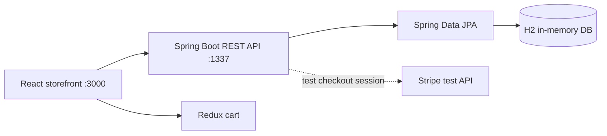

# Ladybag — React + Spring Boot E-commerce Demo

A full-stack portfolio storefront with a **React 18 / Redux Toolkit** frontend and a **Java 17 / Spring Boot** REST backend.

**Status:** Local development demo. The backend includes an in-memory H2 database seeded with four sample bags and an optional **Stripe test-mode** checkout integration. This is **not a production commerce system**; payments and order fulfillment have not been end-to-end verified.

## Features

- Browse seeded products and view item details
- Add products to a Redux shopping cart and change quantities
- Billing, shipping, and contact forms
- Java REST API returning the product/image shape expected by the existing frontend
- Server-side product-price lookup for Stripe test Checkout session creation
- H2 database for easy local setup

## Architecture



## Requirements

- Node.js and npm
- JDK 17
- Maven 3.9+ (for the backend)
- Optional: Stripe **test** secret key, for checkout only

## Run locally

**Terminal 1 — backend:**

```bash
cd backend
mvn spring-boot:run
```

Backend: `http://localhost:1337`. Product data is seeded automatically on each start; the H2 database is in-memory and resets when the server stops.

**Terminal 2 — frontend (from repository root):**

```bash
npm ci
npm start
```

Frontend: `http://localhost:3000`.

## REST API

### List products

```bash
curl "http://localhost:1337/api/items?populate=image"
```

Response uses the Strapi-like structure required by the existing React components:

```json
{
  "data": [
    {
      "id": 1,
      "attributes": {
        "name": "Classic Shoulder Bag",
        "category": "bestSellers",
        "price": 89.00,
        "shortDescription": "Everyday shoulder bag",
        "longDescription": "A classic bag for everyday use.",
        "image": { "data": { "attributes": { "formats": { "medium": { "url": "https://raw.githubusercontent.com/..." } } } } }
      }
    }
  ]
}
```

### Get one product

```bash
curl "http://localhost:1337/api/items/1?populate=image"
```

### Create a Stripe test checkout session

The backend requires `STRIPE_SECRET_KEY` set to a Stripe **test** secret key (`sk_test_...`). **Never commit the secret key.** The backend calculates prices from its own product catalog rather than trusting frontend prices.

```bash
curl -X POST http://localhost:1337/api/orders \
  -H "Content-Type: application/json" \
  -d '{"userName":"Demo Customer","email":"demo@example.com","products":[{"id":1,"count":2}]}'
```

With a valid Stripe test configuration, the response contains a session `id` used by Stripe.js. Without it, checkout returns HTTP 503; browsing still works. Set `FRONTEND_URL` if the frontend is not at `http://localhost:3000`.

The React frontend currently uses a Stripe **publishable test key** in `src/scenes/checkout/Checkout.jsx`. Replace it with your own matching test account key when configuring Stripe. The confirmation screen intentionally does **not** claim payment success: production order confirmation requires server-side session verification or webhooks.

## Tests

Backend:

```bash
cd backend
mvn test
```

Frontend:

```bash
npm test
npm run build
```

The backend includes catalog endpoint integration tests. The complete frontend/backend/Stripe flow has not been run or verified in this update.

## Known limitations and next steps

- H2 data is ephemeral; migrate to PostgreSQL for persistent product and order records.
- Add authenticated admin product management, inventory, order persistence, and Stripe webhooks.
- Configure API and Stripe publishable keys through frontend environment variables.
- Improve checkout error display and validation, and test the complete payment flow.
- Fix the frontend `homepage` deployment URL and add automated frontend tests.
- Add screenshots and a live demo once deployed.

## Source

[Ladybag on GitHub](https://github.com/davidtshisekedi89/ladybag)
