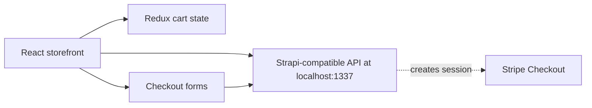

# Ladybag — React E-commerce Frontend

A portfolio e-commerce storefront built with **React 18**, **Redux Toolkit**, **Material UI**, **Formik**, and **Yup**. It demonstrates product browsing, cart state management, and a multi-step checkout interface.

> **Project status:** Frontend prototype. The application expects a separate Strapi-compatible backend on `http://localhost:1337`, which is **not included in this repository**. Payment processing and completed orders are not verified end to end.

## Features

- Product browsing and item-detail routes
- Shopping cart with quantity adjustments and subtotal calculation
- Billing, shipping, and contact forms
- Form validation with Formik and Yup
- Stripe Checkout client-side integration (requires a functioning backend)
- Responsive UI components using Material UI

## Tech stack

React, React Router, Redux Toolkit, Material UI, Emotion, Formik, Yup, Stripe.js, Create React App.

## Architecture



## Getting started

1. Install **Node.js** and npm.
2. Clone this repository and install dependencies:

   ```bash
   git clone https://github.com/davidtshisekedi89/ladybag.git
   cd ladybag
   npm ci
   ```

3. Start a compatible backend on `http://localhost:1337`. The frontend expects product and image data from that service. Backend setup, seed data, and Stripe server integration are not provided here.
4. Run:

   ```bash
   npm start
   ```

5. Open `http://localhost:3000`.

Without the backend, catalog images, product data, and checkout requests may fail.

## Routes

| Route | Description |
| --- | --- |
| `/` | Storefront and product catalog |
| `/item/:itemId` | Product details |
| `/checkout` | Multi-step checkout form |
| `/checkout/succes` | Confirmation screen (the route spelling is currently `succes`) |

## Backend integration

The frontend expects a product API compatible with its Strapi data structures and a checkout-session endpoint:

```http
POST http://localhost:1337/api/orders
Content-Type: application/json

{
  "userName": "Example Customer",
  "email": "customer@example.com",
  "products": [{ "id": 1, "count": 2 }]
}
```

The checkout code expects a JSON response containing a Stripe Checkout `id`. This is a **frontend integration contract**, not proof that the backend endpoint is deployed or functional.

## Testing and build

```bash
npm test
npm run build
```

The repository does not currently include dedicated component or checkout tests. Build and runtime behavior have not been independently verified.

## Recommended next steps

1. Provide a backend repository, sample product data, and environment-based API configuration.
2. Fix the `homepage` setting in `package.json` before deploying to GitHub Pages.
3. Verify Stripe checkout server-side before displaying a successful order confirmation.
4. Fix the checkout route spelling and validate shipping/email fields.
5. Add cart and checkout tests, screenshots, and a working demo link once available.

## Source

[GitHub repository](https://github.com/davidtshisekedi89/ladybag)
